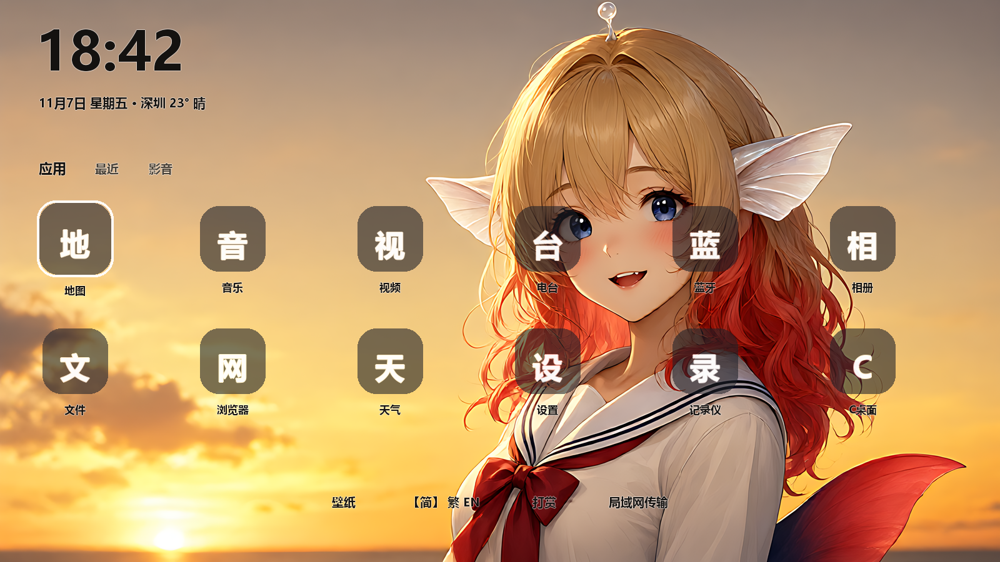
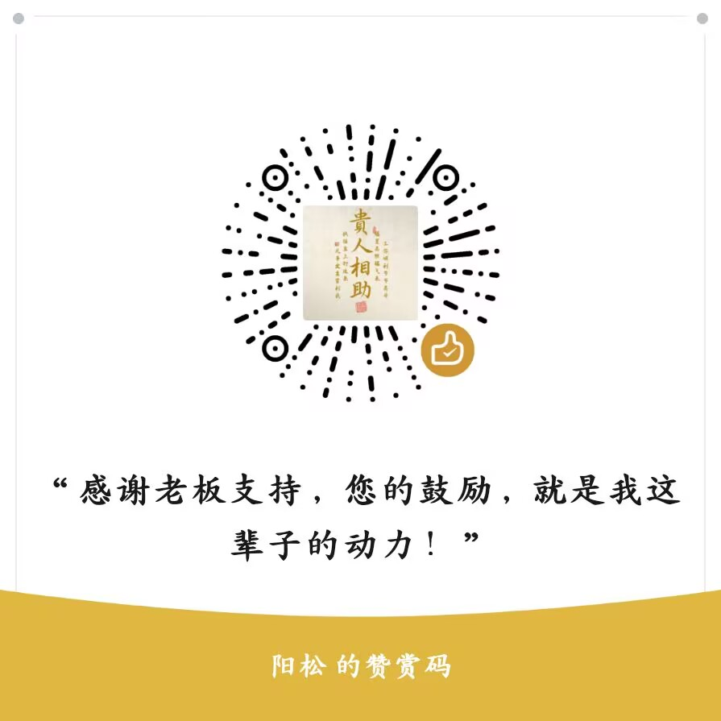

# CDesk / C桌面

> **C = Car · Clean · Cheap**
> A clean, ad-free home screen for old car head units, TV boxes, and Android TV.

[中文](README.md) | [English](README.en.md)

## What is this

Millions of car head units and TV boxes made between 2015–2022 still work fine, but their stock
launchers are slow, ugly, and full of ads. **CDesk does four things:**

| Feature | Notes |
|---|---|
| 🖥 Home replacement | Three pages (Apps / Recent / Media), D-pad navigation |
| 🌙 Built-in 4K wallpapers | Golden Hour / Whale Night / Morning Light, auto day-night switch (light wallpaper 6:00–18:00) |
| 📶 Live network speed | Floating badges in both bottom corners, pure `TrafficStats` sampling |
| 📁 LAN file transfer | Built-in HTTP server — scan a QR code from your phone and send APKs to the unit |

Also: in-app language switch (Simplified / Traditional / English), IP-based weather, donation code,
first-launch terms of use.

## Install

1. Push to GitHub — the [workflow](.github/workflows/android.yml) builds the APK automatically
2. Download `cdesk-com.c.launcher` from the run's Artifacts
3. Copy to your device and install
4. Press Home, pick CDesk as the default launcher

Local build: `./gradlew assembleDebug` (JDK 17 + Android SDK).

## Why it runs on old devices

One APK from **minSdk 16 (Android 4.1)** to **targetSdk 34**. Every API gap is branch-handled:
overlay window types, foreground service start, notification channels, Material theme on v21+,
`<queries>` for Android 11 package visibility, and `touchscreen required=false` so TV boxes can
install it. 4K wallpapers decode with an `inSampleSize` guard against OOM on 1080p panels.

## Theming

12 hand-tuned palettes (Aurora, Neon Sea, Mint Night, Sakura Pink, Volcano, Volt, Pure Black,
Blue Night + 4 light ones), colors derived from the Tailwind CSS v4 palette. Text auto-inverts
against the wallpaper by perceived brightness.

## Support / Donate

If CDesk gave your old head unit a few more years, a donation is appreciated. **Donations unlock
nothing — everything is free forever.** WeChat QR code:

No payment SDK, no "donate to unlock" — just a static image. Swap the code by replacing one file.

## AI assets

All illustrations and wallpapers are AI-generated and shipped with the repo, free to use.
Generated through [Minekuai](https://minekuai.cn/r/MVQ5W8MT) (an explicit referral link; both
sides get a small credit bonus; mainland China networks only).

## License

[MIT](LICENSE)
