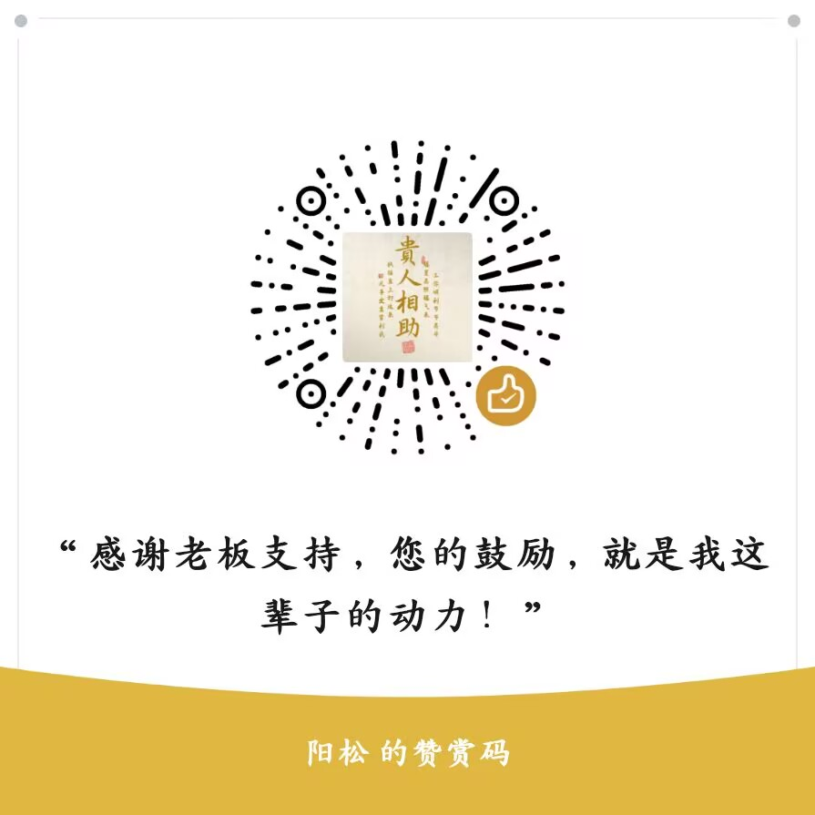

<p align="center"></p>

# C桌面 / CDesk

[中文](README.md) | [English](README.en.md)

> **C = Car · Clean · Cheap**
> 给老车机、电视盒子、Android TV 用的一块干净桌面。没有广告，没有推荐流。

**官网（国内直连）：[https://gcy5.cn.mt](https://gcy5.cn.mt)** —— 功能介绍、安装步骤、常见问题、加群/反馈都在这。


---

## 这是什么

中国有大量 2015–2022 年的车机、电视盒子，硬件还能用，但系统桌面卡、丑、广告多，官方早就不更新了。

**C桌面 只做四件事：**

| 能力 | 说明 |
|---|---|
| 🖥 替换默认桌面 | 三页桌面（应用 / 最近 / 影音），遥控器方向键翻页 |
| 🌙 壁纸 | 一个自定义色 + 两个日间壁纸 + 一个夜间壁纸 + 最多 3 张自定义照片，可开日夜自动（6:00–18:00 用日间）
| 📶 实时网速 | 左右下角悬浮显示，纯 `TrafficStats` 差值采样，零唤醒代价 |
| 📁 局域网传文件 | 内置 HTTP 服务，手机扫码/输地址就能往车机传 APK |

另有：应用内语言切换（简 / 繁 / EN，当前语言高亮显示）、IP 自动定位天气、首次启动使用须知。

> 壁纸与更新发布、bug 反馈、功能建议，请到公众号「**韭菜超先生**」——丢失了 APK 也从这里找回。

> 也可以直接进 QQ 群「**C桌面会员群**」（群号 **970805386**）：<https://qm.qq.com/q/aNyk2ZG3ZK> —— 安装求助、功能许愿、新版本先发群里。

<p align="center">
  <br>
  <sub>微信扫码关注「韭菜超先生」</sub>
  &nbsp;&nbsp;&nbsp;&nbsp;
  <br>
  <sub>QQ 群 970805386 · <a href="https://qm.qq.com/q/aNyk2ZG3ZK">一键加群</a></sub>
</p>

---

## 安装

### 下载 APK（国内推荐加速线路）

**可以先去官网 [gcy5.cn.mt](https://gcy5.cn.mt) 看一眼再决定装不装** —— 页面底部有完整下载入口。

最新版见 [Releases](https://github.com/gcy529/CDesk/releases/latest)：

- [GitHub 直链](https://github.com/gcy529/CDesk/releases/latest)（海外快）
- [GHFast 加速](https://ghfast.top/https://github.com/gcy529/CDesk/releases/latest)（国内推荐）
- [GH-Proxy 加速](https://gh-proxy.com/https://github.com/gcy529/CDesk/releases/latest)（备用）

每个版本附 SHA-256 校验值。装不上、下不动，到公众号「韭菜超先生」反馈。

### 本地构建

```bash
# 需要 JDK 17 + Android SDK
./gradlew assembleDebug
# 产物：app/build/outputs/apk/debug/app-debug.apk
```

### 装上之后

安装后按 Home 键，系统弹出「选择桌面」，选 C桌面 并设为默认。
部分车机固件锁死了 Home 键：从应用列表里点「C桌面」自己那一项，也能唤出选择框。

---

## 为什么它能跑在老设备上

minSdk 16（Android 4.1）到 targetSdk 34（Android 14+），同一个 APK。每一处版本差异都有分支：

| 坑 | 处理方式 |
|---|---|
| 悬浮窗类型 | `SDK >= 26 ? TYPE_APPLICATION_OVERLAY : TYPE_PHONE` |
| 前台服务 | `SDK >= 26 ? startForegroundService : startService` |
| 通知渠道 | `SDK >= 26` 才创建 `NotificationChannel` |
| 主题 | `values/` 用 `Theme.NoTitleBar.Fullscreen`，`values-v21/` 才用 Material |
| 应用可见性 | manifest 声明 `<queries>`，Android 11+ 也能列出应用 |
| 无触摸屏 | `<uses-feature touchscreen required="false">`，车机/TV 才装得上 |

4K 壁纸解码带 `inSampleSize` 安全阀：4K 电视吃全图，1080p 老屏自动降采样，防 OOM。

---

## 界面

纯色模式下可在几组配色间循环；壁纸模式下文字按壁纸明暗自动反色。
网速悬浮窗颜色同样按壁纸亮度自动黑/白。


---

## 局域网传输

车里没有 USB、没有文件管理器的时候：

```
手机和车机连同一个 Wi-Fi
→ 车机上打开「局域网传输」
→ 屏幕显示二维码和 http://192.168.x.x:8080
→ 手机扫码或输地址
→ 选文件，点发送
```

纯 `ServerSocket` 实现，端口按 8080/8081/8088/8888/9090 依次找空位。

---

## 目录结构

```
app/src/main/
├── java/com/c/launcher/
│   ├── MainActivity.java             桌面主界面：时钟 / 三页 / 壁纸 / Dock
│   ├── AppAdapter.java               已安装应用列表（D-pad 可导航）
│   ├── WPManager.java                内置壁纸 + 日夜自动 + 按屏解码
│   ├── WallpaperSettingsActivity.java 壁纸选择（缩略图卡片）
│   ├── DisclaimerActivity.java       首次启动使用须知
│   ├── LangManager.java              应用内简/繁/EN 切换
│   ├── WeatherManager.java           IP 定位天气（ipwho.is + open-meteo）
│   ├── ThemeManager.java             配色兜底 + 文字/背景颜色动画
│   ├── SpeedService.java             前台服务，每秒采样 TrafficStats
│   ├── SpeedOverlay.java             左右下角网速悬浮胶囊（自动黑白）
│   ├── AutoContrast.java             壁纸亮度采样 → 自动黑白
│   ├── TransferActivity.java         局域网 HTTP 文件接收 + 二维码
│   ├── SetupActivity.java            首次引导（设默认桌面 / 悬浮窗权限）
│   ├── DonateActivity.java           打赏码
│   ├── MediaAdapter.java             影音页入口卡片
│   └── ShellPlaceholderActivity.java 影视壳/音乐壳占位
├── assets/transfer.html              手机端上传页面
└── res/                              四语文案（简/繁台/繁港/EN）+ 布局
```

---

## 路线图

- [x] 桌面骨架 + 三页 + 应用网格
- [x] 网速悬浮窗 + 自动黑白
- [x] 内置 4K 壁纸 + 日夜自动
- [x] 局域网传输 + 二维码
- [x] 简繁英切换 + 使用须知
- [x] 影视壳 / 直播壳 / 音乐壳 —— 仅播放器能力，内容自行导入、自行负责
- [x] 自定义图片壁纸（最多 3 张，存于应用私有目录）

---

## 支持 / Support

如果这个项目让你的老车机多活了几年，欢迎打赏。**打赏不解锁任何功能，所有功能永远免费。**

<p align="center">
  
</p>

**打赏不解锁任何功能；打赏码就是一张静态图片，不接任何支付 SDK。**

---

## 免责声明 / Disclaimer

**一、作品性质。** 本应用系个人开发者独立完成的免费工具，按「现状」提供，不作任何明示或默示的担保，包括但不限于适销性、特定用途适用性及不侵权之担保。使用本应用的风险由使用者自行承担；在法律允许的最大范围内，作者不对因使用或无法使用本应用而产生的任何直接、间接、附带、特殊或后果性损失承担责任。

**二、内容与播放器。** 本应用不内置、不分发任何内容；影音页仅为播放器入口，所播内容由使用者自行导入并自行负责，请遵守所在地法律法规。

**三、第三方名称。** 本应用与任何内容平台、版权方、设备厂商均无隶属、授权或合作关系；所涉商标、名称归其各自权利人所有。

**四、源码与许可。** 源码公开于本仓库，以 [CC BY-NC-ND 4.0](LICENSE) 授权；APK 不收费、不接入任何支付 SDK。

---

## 开发说明 / How this was built

本项目是个人作品，**代码与设计的实现过程在 DeepSeek 辅助下完成**；
产品判断、取舍与发布由作者本人负责。它不是深度求索（DeepSeek）官方产品，
也没有获得其背书或联合署名。

### 用到的服务与素材 / Services & assets

| 项 | 说明 |
|---|---|
| 大模型 API | [麦块云](https://minekuai.cn/r/MVQ5W8MT)（邀请注册链接，注册双方各得 10 鱼币）。项目内的 AI 插画与壁纸经该平台的图像接口生成 |
| 插画 / 壁纸 | 全部由 AI 图像模型生成，随仓库提供，可自由使用 |
| 配色参考 | Tailwind CSS v4 官方调色板（MIT），色值经 OKLab 转换为 sRGB |
| 二维码 | ZXing core（Apache 2.0），纯 Java，无 native 库 |

**关于麦块云（邀请链接 · 国内网络环境）**

项目里的 AI 插画和壁纸，都是通过麦块云的大模型接口生成的。它是一家中转服务，
**国内网络环境下才能正常打开和注册**；在境外或代理环境下可能打不开。
如果你在海外，这一段直接跳过就好，对使用 C桌面没有任何影响。

愿意支持的话，用网页或扫码注册，注册双方各得 10 鱼币，作者会拿到少量额度。
这是**明示的邀请链接**，不改变你实际支付的价格。

[网页注册 minekuai.cn/r/MVQ5W8MT](https://minekuai.cn/r/MVQ5W8MT) · 或扫码：


<details>
<summary><b>About Minekuai (referral link, mainland China networks)</b> — English note, click to expand</summary>

**About Minekuai (referral link, mainland China networks)**

The AI illustrations in this project were generated through Minekuai's model API. It only works
from mainland China networks — from overseas it may not open at all. If you are outside China,
skip this part; it has no effect on using CDesk. The link is an explicit referral link: both sides
get a small credit bonus and the author receives a small quota. It does not change what you pay.

</details>

---

[](https://github.com/deepseek-ai/deepseek-harness)

## License

[CC BY-NC-ND 4.0](LICENSE)
