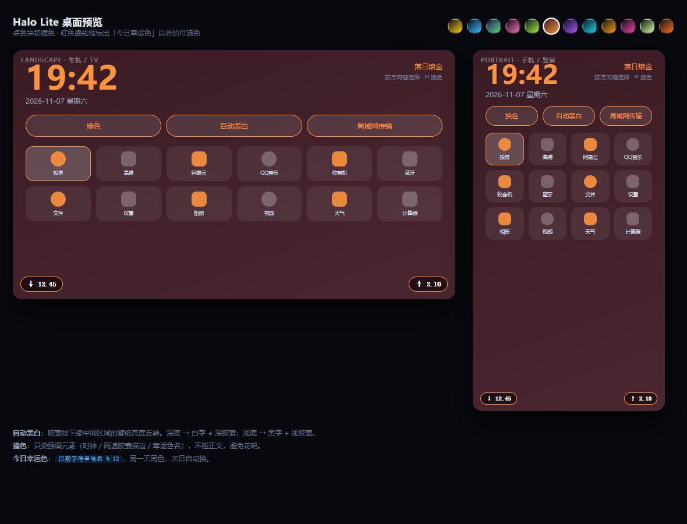
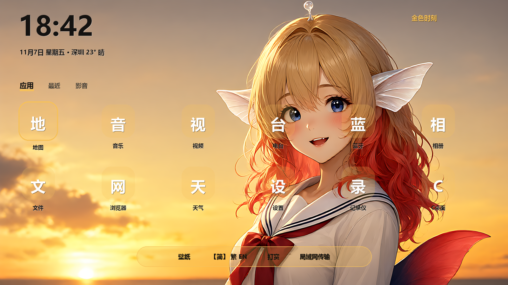

# C桌面 / CDesk

> **C = Car · Clean · Cheap**
> 给老车机、电视盒子、Android TV 用的一块干净桌面。没有广告，没有推荐流，一个 APK 从 Android 4.0 跑到 15。



---

## 这是什么

中国有大量 2015–2022 年的车机、电视盒子、Android TV 设备，硬件还能用，但：

- 系统桌面卡、丑、广告多
- 官方早就不更新了
- 装个大厂 App 就卡死

**C桌面 只做四件事，每件都做到极致轻：**

| 能力 | 说明 |
|---|---|
| 🖥 替换默认桌面 | 声明 `CATEGORY_HOME`，长按 Home 即可设为默认 |
| 📶 左右下角实时网速 | 纯 `TrafficStats` 差值采样，1 秒一次，零唤醒代价 |
| 🎨 撞色 / 今日幸运色 | 12 组手工调色，日期哈希决定当天颜色，次日自动换 |
| 📁 局域网传文件 | 内置 HTTP 服务，手机扫码/输地址就能往车机传 APK |

---

## 功能全表

- **内置壁纸**：鲸夜（半写实鲸鱼女·夜间默认）/ 晨光（白天）/ 金色时刻，全部 AI 生成、可自由使用；支持日夜自动切换与纯色模式
- **使用须知**：首次启动弹一次；应用不内置任何影视/音乐源，内容合规由用户自行负责
- **公众号**：设置里可看「韭菜超先生」

- 三页桌面（应用 / 最近 / 影音），遥控器方向键翻页
- 影音页是内置影视壳 / 音乐壳的入口，不列第三方播放器
- 应用内语言切换：简 / 繁 / EN / 跟随系统，一个按钮循环
- 12 套开源配色（8 深 + 4 浅），日夜自动切换（6:00–18:00 浅色）
- 天气预报：IP 自动定位，免费无 key，全国家自动适配
- 局域网传输：手机扫码直达，免输 IP

## 为什么它能跑在 Android 4.0 上

这不是"声称兼容"，是每一处都做了版本分支：

| 坑 | 处理方式 |
|---|---|
| 悬浮窗类型 | `SDK >= 26 ? TYPE_APPLICATION_OVERLAY : TYPE_PHONE` |
| 前台服务 | `SDK >= 26 ? startForegroundService : startService` |
| 通知渠道 | `SDK >= 26` 才创建 `NotificationChannel` |
| 主题 | `values/` 用 `Theme.NoTitleBar.Fullscreen`，`values-v21/` 才用 Material |
| 颜色动画 | 用 `ArgbEvaluator`（API 1）而不是 `ValueAnimator.ofArgb`（API 21） |
| 应用可见性 | manifest 里声明 `<queries>`，Android 11+ 也能列出应用 |
| 无触摸屏 | `<uses-feature touchscreen required="false">`，车机/TV 才装得上 |

**minSdk 14 / targetSdk 34** —— 从 2011 年的机器到最新系统，同一个 APK。

---

## 自动黑白是怎么做的

悬浮窗挂在任意壁纸上，蓝色或白色文字总有一种会看不清，所以颜色必须**从壁纸本身算**：

```
1. WallpaperManager.getDrawable() 取壁纸（缓存 30s）
2. 按悬浮窗的屏幕坐标裁出它下面那一小块
3. 缩到 8x8，读 64 个像素
4. 感知亮度 = (0.299R + 0.587G + 0.114B) / 255
5. 亮度 < 0.62 → 白字 + 深色胶囊
   亮度 ≥ 0.62 → 黑字 + 浅色胶囊
6. 每 2 秒重采样一次
```

一次采样不到 0.5ms，2 秒才一次，老车机毫无压力。

---

## 撞色 / 幸运色

12 组**手工挑过**的配色（不是色相环算出来的，公式调出来的经常发脏）：

```
深海荧光  #0B1020 → #1E2A4A  强调 #FACC15
暗夜冰蓝  #0B1020 → #16243D  强调 #38BDF8
幻紫霓虹  #2B1055 → #3B1E6E  强调 #4ADE80
墨黑樱粉  #0C0F16 → #1A1F2E  强调 #F472B6
...共 12 组
```

- **今日幸运色**：`hash("2026-11-07") % 12`，同一天所有设备同色，次日自动轮换
- **我的幸运色**：手动点过就存 `SharedPreferences`，盖过今日
- **切换动画**：300ms 颜色流动，不是硬切

强调色只染时钟 / 胶囊描边 / 选中框，**不碰正文**，所以永远不会花。

---

## 局域网传输

车里没有 USB、没有文件管理器的时候：

```
手机和车机连同一个 Wi-Fi
→ 车机上打开「局域网传输」
→ 屏幕上显示 http://192.168.x.x:8080
→ 手机浏览器打开这个地址
→ 选文件，点发送
```

纯 `ServerSocket` 实现，**不依赖任何第三方库**，端口按 8080/8081/8088/8888/9090 依次找空位。

---

## 构建

### 本地

```bash
# 需要 JDK 17 + Android SDK
./gradlew assembleDebug
# 产物：app/build/outputs/apk/debug/app-debug.apk
```

### 没有 Android 环境？

推到 GitHub，[Actions](.github/workflows/android.yml) 会自动编译并把 APK 挂在构建产物里，直接下载安装。

---

## 体积

目标 **5–10 MB**（不追求极限压缩，内容要够用）：

- 零第三方依赖，没有 AndroidX、没有 AppCompat
- `resConfigs "zh", "en"` 只保留中英文
- 图标用矢量 `layer-list`，不做多套 png
- Release 开 `minifyEnabled` + `shrinkResources`

---

## 目录结构

```
app/src/main/
├── java/com/cdesk/launcher/
│   ├── MainActivity.java      桌面主界面：时钟 / 应用网格 / 撞色切换
│   ├── AppAdapter.java        已安装应用列表（D-pad 可导航）
│   ├── SpeedService.java      前台服务，每秒采样 TrafficStats
│   ├── SpeedOverlay.java      左右下角两个悬浮胶囊
│   ├── AutoContrast.java      壁纸亮度采样 → 自动黑白
│   ├── ThemeManager.java      12 组撞色 + 今日幸运色 + 颜色动画
│   └── TransferActivity.java  局域网 HTTP 文件接收
├── assets/transfer.html       手机端上传页面（内嵌服务端返回）
└── res/                       双语文案 + 布局 + 矢量图标
```

---

## 路线图

- [x] 桌面骨架 + 应用网格
- [x] 左右下角网速悬浮窗
- [x] 自动黑白 + 撞色 / 幸运色
- [x] 局域网传输
- [ ] 高德车机版四灯接入
- [ ] 音乐播放平替（桌面内嵌）
- [ ] PCDN 上传异常提醒（持续 > 2Mbps 超 10 分钟）
- [ ] 自定义壁纸 + 撞色自动提取

---

## 支持 / Support

如果这个项目让你的老车机多活了几年，欢迎打赏。**打赏不解锁任何功能，所有功能永远免费。**


**技术上的取舍，有意为之：**

- **不接任何支付 SDK** —— 个人开发者申请不到微信/支付宝的 App 支付权限，
  第三方聚合支付既踩合规灰线，又会往 APK 里塞好几 MB。APK 只放一张静态图片。
- **不做「打赏解锁主题」** —— 技术上无法验证真伪；更重要的是，一旦带了对价，
  就从「赞赏」变成「经营行为」，税务和平台风控的定性完全不同。
- 换收款码只需要替换 `app/src/main/res/drawable-nodpi/qr_wechat.jpg`，**不改一行代码**。

---

## 开发说明 / How this was built

本项目是个人作品，**代码与设计的实现过程在 DeepSeek 辅助下完成**；
产品判断、取舍与发布由作者本人负责。它不是深度求索（DeepSeek）官方产品，
也没有获得其背书或联合署名。

This is an independent personal project. Code and design work were produced with
assistance from DeepSeek; all product decisions and the release are the author's own.
It is **not** an official DeepSeek product and carries no endorsement.
### 用到的服务与素材 / Services & assets

| 项 | 说明 |
|---|---|
| 大模型 API | [麦块云](https://minekuai.cn/r/MVQ5W8MT)（邀请注册链接，注册双方各得 10 鱼币）。项目内的 AI 插画与壁纸经该平台的图像接口生成 |
| 插画 / 壁纸 | 全部由 AI 图像模型生成，随仓库提供，可自由使用；**不含任何第三方画师作品的复用** |
| 配色参考 | Tailwind CSS v4 官方调色板（MIT），色值经 OKLab 转换为 sRGB |
| 二维码 | ZXing core（Apache 2.0），纯 Java，无 native 库 |

**关于麦块云（邀请链接 · 国内网络环境）**

项目里的 AI 插画和壁纸，都是通过麦块云的大模型接口生成的。它是一家中转服务，
按我这边实测，**国内网络环境下才能正常打开和注册**；在境外或代理环境下可能打不开。
如果你在海外，这一段直接跳过就好，对使用 C桌面没有任何影响。

愿意支持的话，用网页或扫码注册，注册双方各得 10 鱼币，作者会拿到少量额度。
这是**明示的邀请链接**，不改变你实际支付的价格。

[网页注册 minekuai.cn/r/MVQ5W8MT](https://minekuai.cn/r/MVQ5W8MT) · 或扫码：


**About Minekuai (referral link, mainland China networks)**

The AI illustrations in this project were generated through Minekuai's model API. It is a relay
service that, as far as I can tell, only works from mainland China networks — from overseas it may
not open at all. If you are outside China, skip this part; it has no effect on using CDesk.

The link is an explicit referral link: both sides get a small credit bonus and the author receives
a small quota. It does not change what you pay.

### 项目形象 / Mascot



*桌面布局示意 —— 真机图标为设备内应用的真实图标，此处仅示意*

**默认壁纸「金色时刻」**


**备选「鲸夜」**


**备选「晨光」**


[](https://github.com/deepseek-ai/deepseek-harness)

## License

[MIT](LICENSE)

